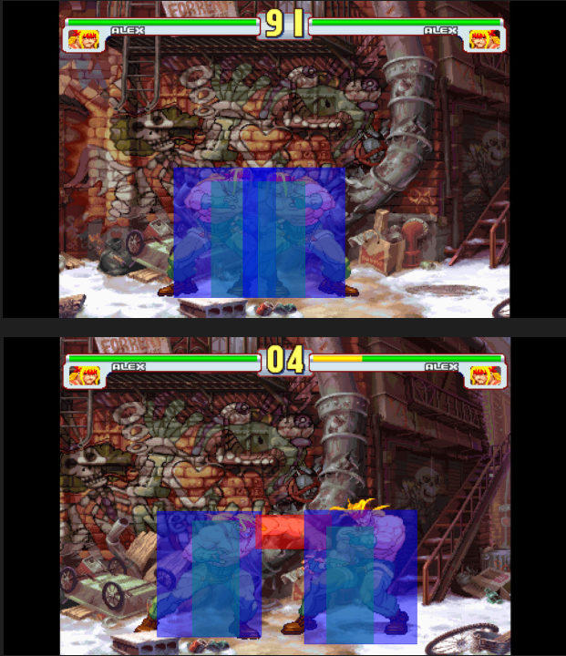
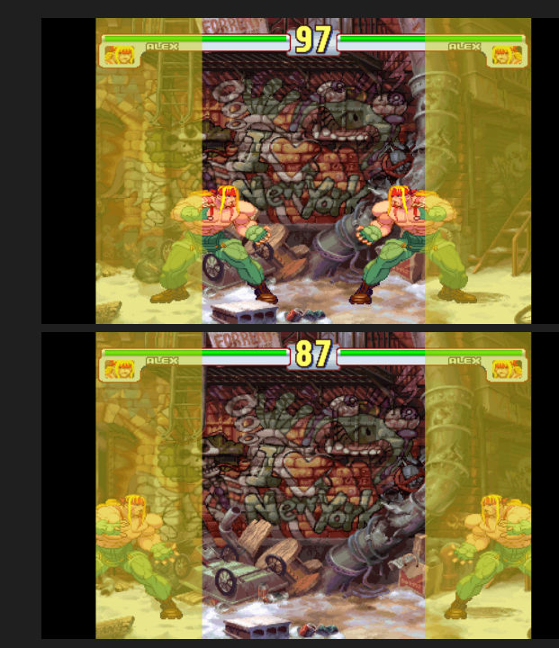

# Kastagne: a 2D fighting game in C++ / SDL2

[](https://github.com/tvallot/2d-fighting-game-cpp/actions/workflows/ci.yml)

A two-player, local versus fighting game written from scratch in C++ with SDL2: sprite-atlas animation, a state machine per fighter, frame-by-frame collision / hit / hurt boxes, a camera that follows both players, a HUD and a full menu flow.

Second-year project of the Bachelor's in Computer Science (Université Claude Bernard Lyon 1, 2024), built by a team of three: **Alexandre Delort, Gaspard Retter and Tanguy Vallot**.

<p align="center">
  
  
</p>

*Left: debug view (F1 to F4), with hurtboxes in blue and the active hitbox of a punch in red. Right: the camera scrolls when a fighter leaves the central zone.*

> **About the assets.** The game was built as a tribute to *Street Fighter III: 3rd Strike*, and the sprites, stages and music used during development belong to Capcom. They are **not included** in this repository; only the code is. See [`data/README.md`](data/README.md) for the files the game expects.

## Highlights

- **Game logic independent of the rendering.** Everything in `src/core` and `src/game` is plain C++ with no SDL dependency. The same rules are driven by two front-ends: an SDL2 window (`src/sdl`) and a terminal version (`src/text`). This is also what makes the logic unit-testable.
- **Fixed-timestep game loop.** The engine updates the simulation in fixed 16 ms steps with an accumulator, independently of the rendering speed, and caps the catch-up after a slow frame.
- **Fighter state machine.** 36 states (stance, walk, dash, jumps, crouch, light / medium / heavy punches and kicks, taunt...) with an explicit table of allowed transitions, so for example an attack cannot be cancelled into a jump.
- **Frame data and boxes.** Each animation frame carries its rectangle in the sprite atlas, a display offset, a duration and three boxes: a collide box (fighters push each other), a hitbox (the attack) and a hurtbox (where the fighter can be hit). A hit is registered when one fighter's hitbox overlaps the other's hurtbox.
- **Camera.** Keeps both fighters on screen, scrolls only when a fighter leaves a central dead zone, and is clamped to the stage edges.
- **Configurable controls.** Key bindings are loaded from JSON ([`Keybind.json`](src/core/json/Keybind.json)) with [nlohmann/json](https://github.com/nlohmann/json), so the layout can be changed without recompiling.
- **Hitbox viewer.** A small standalone tool ([`tools/hitbox_viewer.cpp`](tools/hitbox_viewer.cpp)) plays a sprite animation with its boxes drawn on top. It was used to calibrate the boxes of every frame.

## Architecture

```
src/
├── core/                 game logic (no SDL)
│   ├── fighter/          Fighter (movement, animation, frame data, collisions) + StateMachine
│   ├── camera/           Camera
│   ├── hud/              health bars, timer, round
│   ├── stage/            stage bounds
│   ├── scene/            LoadingScene, SelectScene, BattleScene
│   ├── menu/             main menu
│   └── json/             key bindings
├── game/                 Game: the scene state machine (loading -> menu -> selection -> battle)
├── sdl/                  GameEngine (window, input, rendering, game loop) + SoundManager
├── text/                 terminal front-end
├── mainSDL.cpp
└── mainTxt.cpp
tests/                    one test program per class
tools/hitbox_viewer.cpp   frame data calibration tool
docs/uml/                 UML class diagrams
```

`Game` owns the scenes and switches between them according to a `GameState`. `GameEngine` runs the loop: it reads SDL events, translates them into actions through the key bindings, calls `Game::update` at a fixed rate, then draws the current scene. The UML diagrams in [`docs/uml/`](docs/uml) give the full class structure.

## Building

Requires a C++17 compiler, `make` and the SDL2 development libraries.

```bash
# Debian / Ubuntu
sudo apt install build-essential libsdl2-dev libsdl2-image-dev libsdl2-ttf-dev libsdl2-mixer-dev

make            # bin/kastagne (SDL) and bin/kastagne-txt (terminal)
make test       # unit tests of the game logic
make tools      # bin/hitbox-viewer
make docs       # Doxygen documentation in docs/api (requires doxygen)
```

Run the game from the repository root (`./bin/kastagne`) once the assets are in `data/`. The terminal version (`./bin/kastagne-txt`) and the tests do not need any asset.

## Tests

Each class has a static `regressionTest()` method, and `tests/` contains one small program per class that calls it. `make test` runs the ten game-logic tests and the terminal front-end test; they need neither SDL nor the assets, and run in CI on every push. The two SDL smoke tests (`make test-sdl`) open a window and play audio, so they are run by hand.

## Controls

The default layout targets an AZERTY keyboard and can be changed in [`Keybind.json`](src/core/json/Keybind.json).

| Action | Player 1 | Player 2 |
|---|---|---|
| Walk forward / backward | D / Q | K / M |
| Jump up / forward / backward | Z / E / A | O / I / P |
| Crouch | S | L |
| Dash forward / backward | F / Shift | J / N |
| Light / medium / heavy punch | 1 / 2 / 3 | 8 / 9 / 0 |

Menus: arrow keys, Enter, Escape. Debug: F1 collide boxes, F2 hitboxes, F3 hurtboxes, F4 all.

## Limitations

- Two playable characters; the versus and result screens were not finished.
- Kicks are animated and present in the state machine, but not mapped to keys yet (the `KickMode` binding is a placeholder).
- The frame data is written directly in `Fighter.cpp` (about 1,500 entries). Moving it to one data file per character would make adding fighters much easier.
- The terminal version uses POSIX terminal functions and only runs on Linux / macOS.
